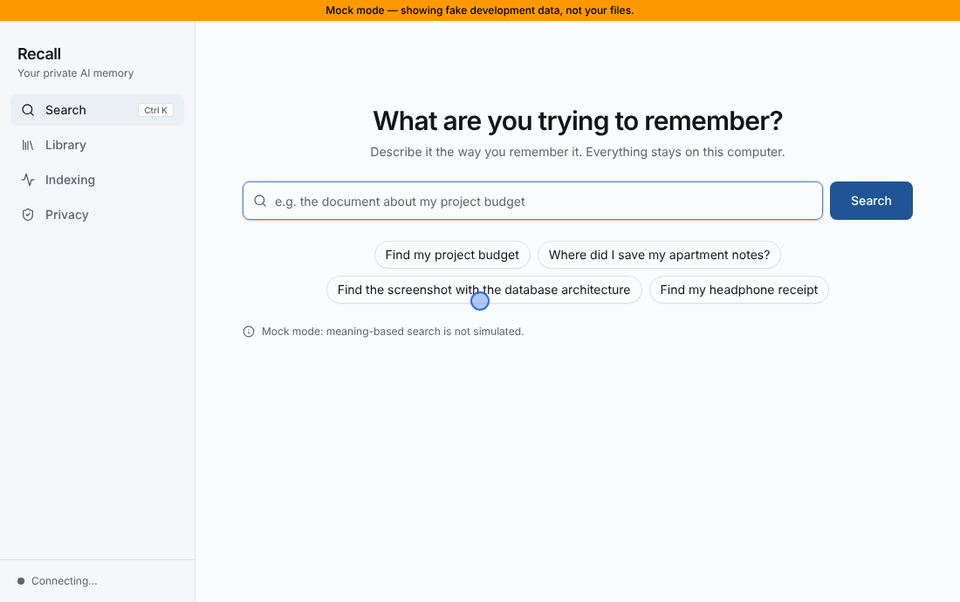

# Recall

**Your private AI memory. Everything searchable. Nothing uploaded.**

[](https://github.com/akanjiolayinka/RECALL/actions/workflows/build.yml)
[](LICENSE)



*A tour of the interface, recorded in mock mode with made-up files. In the
real app, search also matches by meaning across the text of your own files.*

Recall is a free desktop app that searches the files on your computer by
what they say, not just what they're called. You describe what you remember,
like "the receipt for my headphones" or "groceries to buy", and Recall finds
the file and shows you the exact passage that matched. All of it runs on
your own machine: the text recognition, the AI model, the search and the
database.

## Why it exists

Most of us remember what a document said long after we've forgotten its
name or which folder it went into. Normal file search wants the file name,
or at least the exact words, so you end up opening ten files to find one.

AI tools can search by meaning, but they usually do it by sending your
files to someone else's server. For contracts, payslips, medical letters
and receipts, that's a bad trade. Recall does the same kind of search with
small AI models that run locally, so your files never leave your computer.
There's no account to create, no API key to paste in and nothing to pay for.

## What it can do today

- Index folders you choose, and keep them up to date as files are added,
  changed or deleted.
- Read PDF, Word (.docx), plain text and Markdown files, plus the text in
  PNG, JPG and WEBP images using a local OCR model.
- Search three ways at once: by meaning, by keywords and by file name, and
  rank the results together.
- Explain each result in plain words ("Mentions “budget”", "Similar in
  meaning") and show the passage it came from, highlighted inside its page,
  with a button to open the original file.
- Show a Privacy page with facts measured from the running app: where the
  index lives, how big it is and what it holds.

Meaning-based search is the newest part. It passes automated tests with the
real model, but hasn't had much use in the installed app yet. The
[limitations](#current-limitations) below are worth a read before you rely
on it.

## How it works

When you add a folder, Recall walks through it and picks out the file types
it understands. Each new or changed file gets a SHA-256 fingerprint, so on
later scans anything unchanged is skipped. Recall then pulls out the text:
page by page for PDFs, through the local OCR model for images. It cuts the
text into passages of about a thousand characters and stores them in a
SQLite database with a full-text index.

Each passage also goes through a small embedding model,
[BAAI/bge-small-en-v1.5](https://huggingface.co/BAAI/bge-small-en-v1.5),
which turns it into a list of numbers that captures its meaning. When you
search, your query gets the same treatment, and Recall looks for passages
whose meaning is close. At the same time it runs a keyword search (SQLite
FTS5 with English word stemming) and checks file names and titles. The
three scores are combined into one ranking. Recall only shows passages it
actually stored; it never writes or paraphrases text.

A file watcher notices changes in your folders and re-indexes just what
changed. Everything lives in one database file, `recall.db`, in your
app-data folder:

| OS | Location |
| --- | --- |
| Windows | `%APPDATA%\io.github.akanjiolayinka.recall\` |
| macOS | `~/Library/Application Support/io.github.akanjiolayinka.recall/` |
| Linux | `~/.local/share/io.github.akanjiolayinka.recall/` |

Delete that folder to reset Recall. Your own files are only ever read, never
changed or moved.

[docs/ARCHITECTURE.md](docs/ARCHITECTURE.md) goes into more depth, and
[docs/MODELS.md](docs/MODELS.md) records exactly which models are used and
how they were checked.

## Tech stack

Recall is a [Tauri 2](https://v2.tauri.app/) app. The backend is Rust, using
rusqlite (SQLite with FTS5), pdf-extract, [ocrs](https://github.com/robertknight/ocrs)
for OCR, [rten](https://github.com/robertknight/rten) to run the embedding
model, and notify for file watching. The frontend is React 19 and TypeScript
with Vite, Tailwind CSS, shadcn/ui-style components and TanStack Query.

## Getting started

There's no official release yet. Until there is, you can build Recall from
source, as below. If you have a GitHub account, you can also download the
Windows installer that CI builds on every push: open the
[Build workflow](https://github.com/akanjiolayinka/RECALL/actions/workflows/build.yml),
pick the latest green run, and download **Recall-Windows-installer** under
Artifacts. These builds aren't code-signed, so Windows SmartScreen will warn
you; choose **More info**, then **Run anyway**.

### What you need

- [Node.js](https://nodejs.org/) 20.19 or newer (or 22.12+)
- [Rust](https://rustup.rs/) 1.94 or newer
- Tauri's system prerequisites for your OS, listed at
  <https://v2.tauri.app/start/prerequisites/>. On Windows that's the
  Microsoft C++ Build Tools and WebView2. On Linux it's WebKitGTK and a few
  other libraries.

### Run it

```bash
npm install
npm run download-models   # about 145 MB, checksums verified
npm run tauri dev         # the first build takes a few minutes
```

`download-models` puts the AI model files in `models/`. It's the only step
that needs the internet besides installing packages, and you only run it
once. The Rust code won't compile without these files, because they get
bundled into the app.

When the window opens, go to **Library**, click **Add folder**, and choose
`test-data/` to try Recall on the synthetic sample files, or one of your own
folders. Then search from the **Search** page. **Ctrl+K** (or **⌘K**) jumps
there from anywhere.

### Build an installer

```bash
npm run build:app
```

This downloads and checks the models if needed, then runs `tauri build`.
The installers end up in `src-tauri/target/release/bundle/`. The models are
bundled inside, so an installed Recall never downloads anything.

### Work on the interface without Rust

```bash
npm run dev:mock
```

Then open <http://localhost:1420> in your browser. Mock mode swaps the
backend for fake data, so you need neither Rust nor the models. An amber
banner reminds you the data isn't real. It only works in development builds
and can't end up in a release. See
[docs/FRONTEND_QUICKSTART.md](docs/FRONTEND_QUICKSTART.md).

## Privacy

The whole point of Recall is that your files stay yours, so the privacy
rules are strict and checked automatically.

- Recall makes no network requests. The app contains no HTTP, TLS or
  WebSocket client, and its window is locked down so it can only talk to
  Recall's own backend.
- All AI runs on your machine, from model files on disk. Recall never calls
  a cloud AI service.
- There is no telemetry, no analytics, no account and no API key, and there
  never will be. Contributions that add any of these, or any outbound
  network call, won't be accepted. The one exception is the model download
  script, which you run yourself during setup and which is never part of the
  app.
- Logs record technical errors, file IDs and folder paths, never the text
  of your files.

You can check this yourself:

```bash
npm run audit:privacy
```

The audit looks for the usual ways code reaches the internet: network
libraries in the Rust dependencies for Windows, macOS and Linux, socket
code, web requests or addresses in the frontend, network or analytics npm
packages, and the window's security settings. It fails if it finds any of
them, and it runs in CI on every push and pull request. It's a safety net
rather than a proof, so reviewers still read every change with this in
mind.

## Current limitations

- **English only for meaning.** The embedding model is English-only, and
  keyword stemming is English too. Other languages still work for exact
  words and file names.
- **Scanned PDFs aren't read.** A PDF page with no text layer is detected
  and reported, but not run through OCR yet.
- **Meaning-search thresholds come from synthetic data.** They were tuned
  on 24 invented documents and 34 searches (see
  [docs/MODELS.md](docs/MODELS.md)) and may need adjusting on real
  libraries.
- **The first index of a big folder takes time.** Every passage goes through
  the model once. After that only changes are processed.
- **Large folders are re-walked on every change.** Only changed files are
  re-read, but the folder listing is redone each time.
- **File-name matching ignores case for ASCII letters only.**
- **Testing so far is mostly on Windows and Linux.** The macOS build hasn't
  been tried, and there are no published installers yet.

## Where help is wanted

[ROADMAP.md](ROADMAP.md) lists what's planned and unfinished, from OCR for
scanned PDFs to support for other languages. Smaller, self-contained tasks
are in [docs/GOOD_FIRST_ISSUES.md](docs/GOOD_FIRST_ISSUES.md).

## Contributing

Contributions are welcome, whether that's code, testing on a platform we
haven't covered, or fixing a confusing sentence in the docs.
[CONTRIBUTING.md](CONTRIBUTING.md) explains how to set up, how the code is
organised, and what makes a pull request easy to review. These docs help
too:

| Document | What it covers |
| --- | --- |
| [docs/ARCHITECTURE.md](docs/ARCHITECTURE.md) | How Recall works inside |
| [docs/DEVELOPMENT.md](docs/DEVELOPMENT.md) | Debugging and common setup problems |
| [docs/API.md](docs/API.md) | The contract between the frontend and the Rust backend |
| [docs/FRONTEND_QUICKSTART.md](docs/FRONTEND_QUICKSTART.md) | Working on the UI |
| [docs/MODELS.md](docs/MODELS.md) | The AI models and how they were verified |
| [test-data/README.md](test-data/README.md) | The synthetic sample files |

## License and credits

Recall is released under the [MIT License](LICENSE). Third-party components
keep their own licences.

- **Meaning-based search** uses
  [BAAI/bge-small-en-v1.5](https://huggingface.co/BAAI/bge-small-en-v1.5)
  by the Beijing Academy of Artificial Intelligence (MIT licence), run with
  [rten](https://github.com/robertknight/rten) and rten-text by Robert Knight
  (MIT or Apache-2.0).
- **OCR** uses [ocrs](https://github.com/robertknight/ocrs) by Robert Knight
  and the ocrs contributors (MIT or Apache-2.0). Its models were trained on
  Google's [HierText](https://github.com/google-research-datasets/hiertext)
  dataset (CC BY-SA 4.0).

Recall uses all of these models unmodified.
